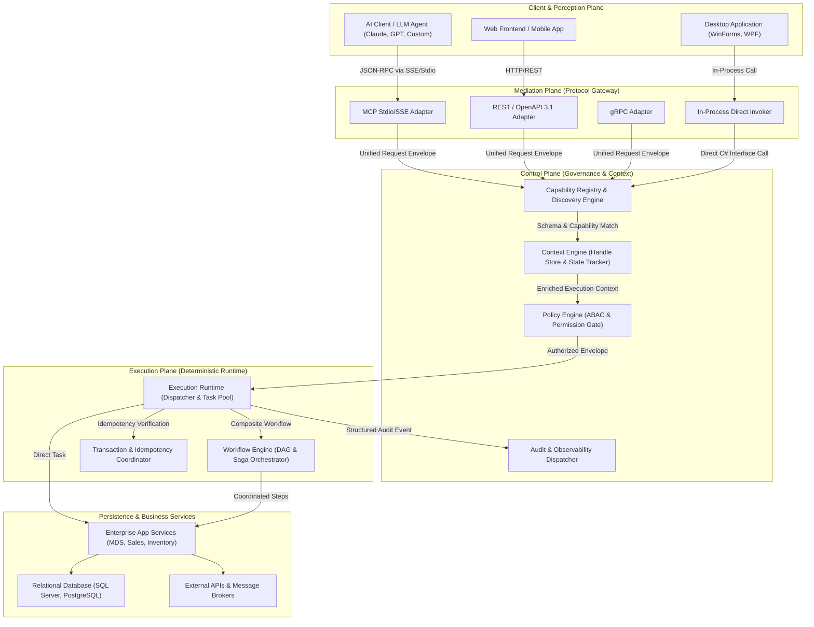
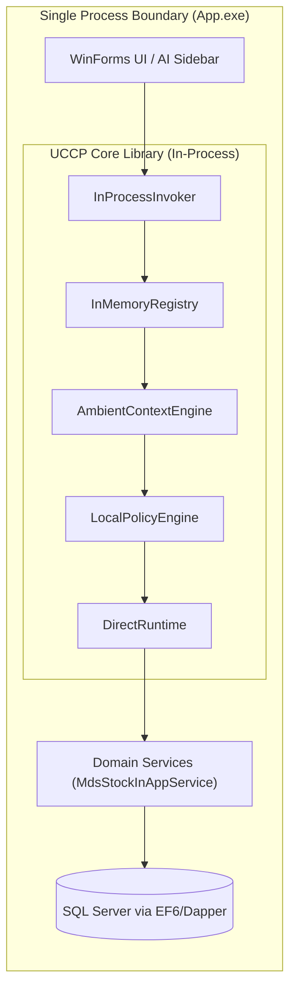
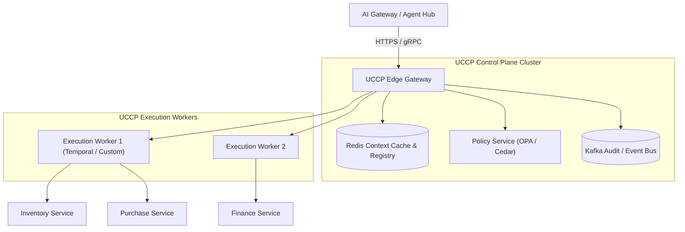
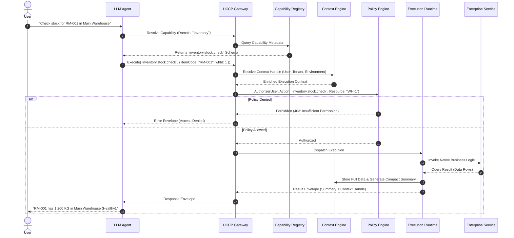

# UCCP Architecture & System Topology

---

## 1. System Decomposition (C4 Level 2 - Container View)

The Universal Context & Capability Protocol (UCCP) is organized into modular, independently testable components. The architecture isolates the probabilistic reasoning of AI models from deterministic enterprise transactions.

---

## 2. Component Responsibilities & Boundary Analysis

### 2.1. Protocol Gateway & Adapters
- **Function**: Ingests incoming requests from heterogeneous network transports (Stdio, SSE, HTTP, gRPC), parses them, and normalizes them into a canonical `UccpRequestEnvelope`.
- **Architectural Boundary**: Must be strictly stateless. Contains **zero** business logic and **zero** database knowledge.

### 2.2. Capability Registry & Discovery Engine
- **Function**: Maintains the catalog of all available enterprise capabilities, their semantic descriptions, hierarchical domain paths, and JSON Schemas.
- **Progressive Discovery**: Provides a 2-stage discovery mechanism:
  1. `DiscoverDomains(intent)`: Returns lightweight domain summaries.
  2. `ResolveCapability(capabilityId)`: Returns the detailed JSON Schema for the selected operation.

### 2.3. Context Engine
- **Function**: Manages the lifecycle, resolution, and isolation of execution context.
- **Context Handles**: Transforms large environmental states (e.g., 5,000-row inventory tables, user authorization tokens, tenant IDs) into opaque, immutable context handles (e.g., `ctx_inv_8f9a2b`).
- **Boundary Justification (Why separate from Policy Engine?)**:
  - The Context Engine manages **State and Data Access** (What is the truth of the environment?).
  - The Policy Engine evaluates **Rules and Decisions** (Is Subject $S$ permitted to perform Action $A$ on Resource $R$ given Context $C$?).
  - Conflating them tightly couples state storage with authorization logic, hindering independent testing and scaling.

### 2.4. Policy Engine (ABAC & Least Privilege)
- **Function**: Evaluates Attribute-Based Access Control (ABAC) policies at execution time.
- **Invariant**: The Policy Engine must intercept every request **after** context resolution and **before** runtime dispatch. Neither the LLM nor the Protocol Gateway can bypass this check.

### 2.5. Execution Runtime & Workflow Engine
- **Function**: The deterministic heart of UCCP.
  - **Direct Execution**: Dispatches atomic operations to underlying C# services or APIs.
  - **Workflow Execution**: Executes composite Directed Acyclic Graphs (DAGs) and Saga patterns (with automated rollbacks/compensations) without round-tripping intermediate steps through the LLM.

---

## 3. Two Deployment Profiles

To accommodate diverse enterprise environments—ranging from legacy on-premise Windows desktop monoliths to distributed cloud-native microservices—UCCP defines two standardized deployment profiles.

### Profile A: Minimal Architecture (In-Process Monolith / Embedded)
Designed for single-process desktop applications (WinForms/WPF), legacy .NET Framework 4.6.2 monoliths, and low-latency local execution.

- **Characteristics**:
  - Zero network serialization overhead ($< 0.5 \text{ ms}$ execution latency).
  - All inter-component calls use native C# interfaces (`IUccpRuntime`, `ICapabilityRegistry`).
  - Memory footprint: $< 15 \text{ MB}$ additional RAM.
  - Autofac or `IServiceProvider` handles dependency injection.

### Profile B: Distributed Architecture (Cloud / Microservices)
Designed for enterprise-scale multi-tenant environments with dozens of independent domain services.

- **Characteristics**:
  - Horizontally scalable Gateway and Execution Workers.
  - Context handles stored in distributed cache (Redis) with TTL and encryption.
  - High-throughput asynchronous message bus (Kafka) for immutable audit trails.
  - Built-in circuit breakers, distributed tracing (OpenTelemetry / W3C Trace Context), and mutual TLS (mTLS).

---

## 4. End-to-End Execution Sequence

The following sequence illustrates a standard UCCP request traversing the system:

