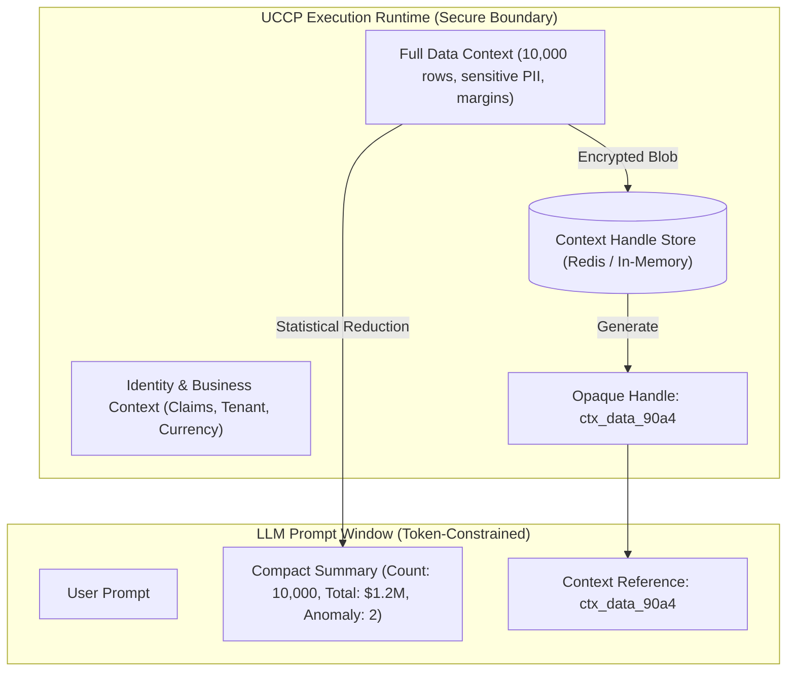
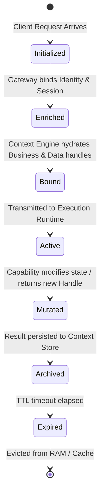

# UCCP Context Model & Memory Architecture

---

## 1. The 7-Tier Context Taxonomy

A central flaw of legacy AI integration architectures is treating all context as unstructured text within the prompt window. UCCP formalizes context into seven strictly typed, isolated architectural tiers:

```
┌─────────────────────────────────────────────────────────────────────────────┐
│                       7-TIER CONTEXT TAXONOMY                               │
├─────────────────────┬───────────────────────────────────────────────────────┤
│ Context Tier        │ Scope & Responsibilities                              │
├─────────────────────┼───────────────────────────────────────────────────────┤
│ 1. **Identity**     │ Authenticated caller identity: `UserId`, `TenantId`,   │
│                     │ `Roles`, `Permissions`, `Department`, `SecurityStamp`. │
├─────────────────────┼───────────────────────────────────────────────────────┤
│ 2. **Business**     │ Active enterprise state: `CompanyId`, `BranchId`,      │
│                     │ `FiscalYear`, `Currency`, `ApprovalThreshold`.        │
├─────────────────────┼───────────────────────────────────────────────────────┤
│ 3. **Session**      │ Transport-level connection: `ClientIp`, `UserAgent`,  │
│                     │ `SessionId`, `Channel` (Desktop, Web, API), `MfaDone`. │
├─────────────────────┼───────────────────────────────────────────────────────┤
│ 4. **Conversation** │ Multi-turn dialog state: `ThreadId`, `TurnIndex`,     │
│                     │ `IntentStack`, `WorkingMemorySummary`.                │
├─────────────────────┼───────────────────────────────────────────────────────┤
│ 5. **Execution**    │ Runtime invariants: `CorrelationId`, `TraceId`,       │
│                     │ `Deadline`, `CancellationToken`, `IdempotencyKey`.    │
├─────────────────────┼───────────────────────────────────────────────────────┤
│ 6. **Environment**  │ Infrastructure state: `Region`, `ClusterId`,          │
│                     │ `DeploymentStage` (Prod/Staging), `FeatureFlags`.     │
├─────────────────────┼───────────────────────────────────────────────────────┤
│ 7. **Data**         │ Opaque handles to operational datasets: active BOM,   │
│                     │ 5,000-row inventory audit table, PDF byte buffers.    │
└─────────────────────┴───────────────────────────────────────────────────────┘
```

---

## 2. Runtime Context vs. Prompt Context (Context $\neq$ Prompt)

UCCP establishes an uncompromising distinction between **Runtime Execution Context** and **Model Prompt Context**:



### The Opaque Context Handle Pattern
When a capability outputs a large or sensitive dataset (e.g., querying 10,000 inventory items):
1. **Persistence in Context Store**: The full dataset is committed to the local/distributed Context Store (with a TTL, e.g., 15 minutes).
2. **Handle Generation**: The runtime generates an opaque, cryptographically signed reference:
   `ctx_handle:inv_stock:a89e-4b21-99c0:tenant_01`
3. **Statistical Projection**: The runtime extracts a token-efficient summary (row count, distribution metrics, outlier IDs) for the LLM.
4. **Subsequent Chained Invocation**: When the LLM decides to trigger a follow-up action (e.g., `inventory.stock.export_excel` or `purchasing.reorder.batch`), it simply passes the `contextHandle`. The Execution Engine hydrates the full dataset directly from the Context Store.
5. **Net Benefit**:
   - Zero token waste (avoids dumping 200,000 tokens into the prompt).
   - Zero hallucination of intermediate rows or calculations.
   - Zero data exfiltration to external LLM providers.

---

## 3. Context Lifecycle & Propagation



### 3.1. Context Propagation Across Distributed Hops
UCCP utilizes standard W3C Trace Context and custom header propagation:
- `traceparent`: W3C distributed trace identifier (`version-trace_id-parent_id-flags`).
- `uccp-context-id`: Root execution context reference.
- `uccp-tenant-id`: Tenant partition identifier.
- `uccp-idempotency-key`: Client-supplied unique operation key.

### 3.2. Context Isolation & Multi-Tenant Boundaries
To strictly prevent cross-tenant data leakage:
1. **Cryptographic Partitioning**: Context handles include the hashed `TenantId` in their signature:
   $$\text{Handle} = \text{Base64URL}(\text{Payload}) + "." + \text{HMAC-SHA256}(\text{Payload}, K_{\text{tenant}})$$
2. **Access Verification**: Before resolving any context handle, the Context Engine verifies that `Requester.TenantId == Handle.TenantId`. A mismatch immediately aborts execution with a `403 TenantIsolationViolation`.
3. **Field-Level Masking**: Sensitive fields (e.g., standard cost `UnitCost`, employee salary `SalaryAmount`) are dynamically stripped or hashed based on the caller's authorization attributes before context summaries are passed to the perception plane.
