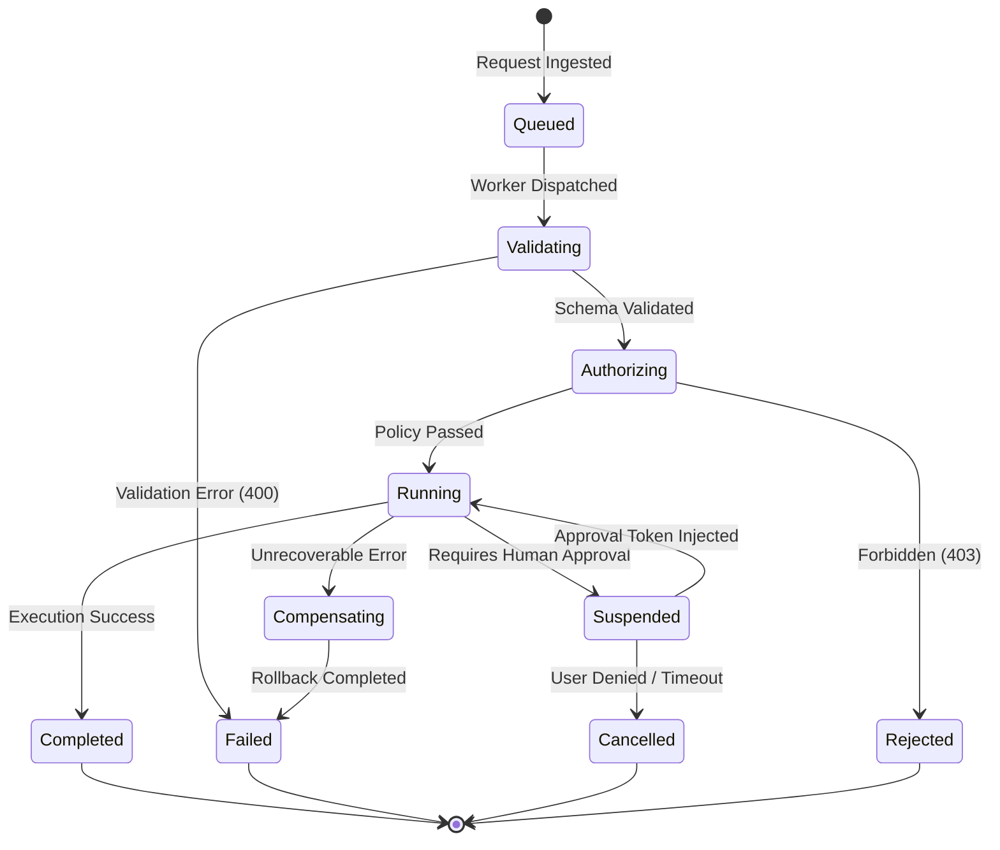

# UCCP Execution Runtime & Reliability Engine

---

## 1. Execution Models

The Execution Runtime is the deterministic computational core of UCCP. It decouples business execution from AI perception, supporting three distinct execution models:

```
┌─────────────────────────────────────────────────────────────────────────────┐
│                          UCCP EXECUTION PARADIGMS                           │
├────────────────────┬────────────────────────────────────────────────────────┤
│ Model              │ Characteristics & Use Case                             │
├────────────────────┼────────────────────────────────────────────────────────┤
│ **Direct**         │ Point-to-point invocation of a single atomic C# service│
│                    │ or API endpoint. Typical latency: $< 50 \text{ ms}$.    │
├────────────────────┼────────────────────────────────────────────────────────┤
│ **Workflow (DAG)** │ Multi-step deterministic sequence or parallel branch   │
│                    │ (e.g., Validate $\to$ Deduct Stock $\to$ Post Ledger).  │
│                    │ Orchestrated entirely in code without LLM hops.        │
├────────────────────┼────────────────────────────────────────────────────────┤
│ **Agentic Loop**   │ Multi-turn cognitive execution where LLM decides next   │
│                    │ step based on intermediate results, bounded by strict  │
│                    │ max-step and budget invariants.                        │
└────────────────────┴────────────────────────────────────────────────────────┘
```

---

## 2. Runtime State Machine & Transitions

Every execution request traverses a formal, deterministic state machine:



### State Definitions
- `Queued`: Placed in the priority dispatch queue awaiting worker allocation.
- `Validating`: JSON Schema and input constraint verification.
- `Authorizing`: Attribute-Based Access Control evaluation by Policy Engine.
- `Running`: Active execution within domain service or workflow worker.
- `Suspended`: Halted awaiting an out-of-band event (e.g., human manager signature).
- `Compensating`: Executing compensating transactions (Saga rollback) due to partial failure.
- `Completed`: Successful execution, output envelope emitted.
- `Failed`: Terminal error reached, diagnostics captured.

---

## 3. Reliability Patterns

### 3.1. Idempotency Key Engine
To eliminate duplicate transactions caused by network retries or LLM re-prompts:
1. Every state-modifying request (`WRITE`, `EXECUTE`) requires a unique `IdempotencyKey` (UUIDv4) in the execution envelope.
2. The runtime checks the Idempotency Store (Redis or SQL):
   - **Key Not Found**: Store `Key` with status `IN_PROGRESS` and 120-second TTL. Proceed to execute.
   - **Key Found & Status = `IN_PROGRESS`**: Return `409 Conflict` (Concurrent execution in progress).
   - **Key Found & Status = `COMPLETED`**: Return the cached `ResponseEnvelope` immediately without re-executing business logic.

### 3.2. Deadlock & Transient Fault Retry (Exponential Backoff with Jitter)
Transient faults (e.g., SQL Server transaction deadlock error 1205, transient network socket drop) are handled deterministically:

$$t_{\text{wait}} = \min\left(t_{\text{max}}, t_{\text{base}} \times 2^{\text{attempt}}\right) \pm \text{RandomJitter}$$

Non-transient errors (e.g., `404 Not Found`, `400 Validation Error`, `403 Forbidden`) **fail immediately** and are never retried.

### 3.3. Compensation & Saga Pattern
For multi-service workflows that span transaction boundaries (e.g., deduct warehouse stock $\to$ debit customer credit $\to$ generate invoice):
- If Step 3 fails, the Workflow Engine automatically executes the compensating actions in reverse topological order:
  $$\text{Compensate}(\text{Step 2}) \longrightarrow \text{Compensate}(\text{Step 1})$$
- Each participating capability must declare a matching compensating capability (e.g., `inventory.stock.deduct` pairs with `inventory.stock.revert_deduction`).

---

## 4. Resource Governance & Budgets

To defend against runaways and resource exhaustion:
1. **Wall-Clock Deadline**: Every request specifies a `deadlineMs`. Execution terminates via `CancellationToken` if exceeded.
2. **Memory Allocation Caps**: Heavy queries stream results through `Span<T>` and paginated cursors; in-memory buffering exceeding 25 MB triggers a spill-to-disk or pagination abort.
3. **Concurrency Throttling**: Execution pools are partitioned by domain (e.g., 20 concurrent threads for Inventory, 5 for heavy Financial Reporting) to prevent report generation from starving critical warehouse operations.
