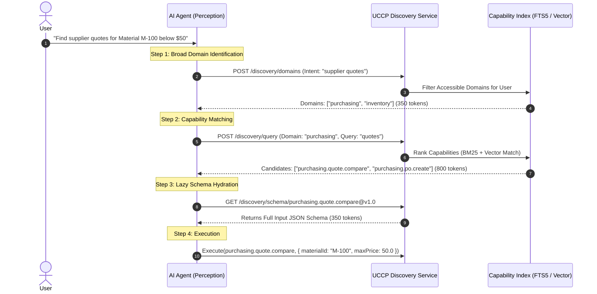

# UCCP Discovery Engine & Token Diet Optimization

---

## 1. The Tool Explosion Dilemma in Enterprise AI

When an AI system connects to an enterprise application suite, it encounters hundreds of distinct endpoints. In conventional MCP implementations, all tool definitions must be bundled into the initial prompt or polled as an exhaustive array.

```
┌─────────────────────────────────────────────────────────────────────────────┐
│                       FLAT REGISTRY VS. UCCP 3-STAGE                        │
├──────────────────────────────────┬──────────────────────────────────────────┤
│ Flat Tool Registration (MCP)     │ UCCP Progressive Discovery               │
├──────────────────────────────────┼──────────────────────────────────────────┤
│ 400 tools $\times$ 350 tokens    │ Stage 1 (Domains): ~350 tokens           │
│ = **140,000 tokens** per request │ Stage 2 (Capabilities): ~900 tokens      │
│ Model context window exhausted   │ Stage 3 (Target Schema): ~350 tokens     │
│ Selection error rate: > 35%      │ **Total: ~1,600 tokens (98.8% savings)** │
│                                  │ Selection accuracy: > 96%                │
└──────────────────────────────────┴──────────────────────────────────────────┘
```

---

## 2. The 3-Stage Progressive Disclosure Protocol



### Stage 1: Domain Signatures (Zero Bloat Index)
Returns a high-level array of available business domains and their single-sentence scopes:
```json
[
  { "domain": "inventory", "summary": "Warehouse stock, material movements, and batch tracking." },
  { "domain": "purchasing", "summary": "Supplier evaluation, purchase orders, and quotes." },
  { "domain": "finance", "summary": "Accounts payable, general ledger, and invoice matching." }
]
```

### Stage 2: Capability Candidates
Returns ranked, permission-filtered capability descriptors without full schemas:
```json
[
  {
    "id": "purchasing.quote.compare@v1.0",
    "name": "Compare Supplier Quotes",
    "description": "Evaluates all active vendor quotes for a material against price thresholds.",
    "action": "READ"
  }
]
```

### Stage 3: On-Demand Schema Hydration
The LLM fetches the formal JSON Schema **only** for the single selected capability immediately before generating the tool invocation arguments.

---

## 3. Permission-Aware Discovery Filtering

A critical security flaw of standard registries is leaking internal infrastructure details (e.g., exposing `admin.salary.modify` schemas to warehouse workers).

In UCCP, the Discovery Engine executes an **Access Control Pre-Filter**:
1. When `DiscoverDomains` or `DiscoverCapabilities` is called, the Gateway extracts the caller's verified `ClaimsPrincipal`.
2. The Registry performs an index join against the Policy Engine:
   $$\text{VisibleCapabilities} = \{ c \in \text{AllCapabilities} \mid \text{Policy}(\text{Caller}, c.\text{action}, c.\text{id}) \neq \text{DENY} \}$$
3. Unauthorized capabilities are completely omitted from the discovery response. An unauthorized user cannot discover, view schemas for, or execute restricted capabilities.

---

## 4. Result Compression & Semantic Compaction

When a capability returns data to the LLM:
1. **Raw Database Output**: 2,000 JSON objects containing 40 columns each ($> 150 \text{ KB}$, 45,000 tokens).
2. **Compact Result Projection**: The runtime automatically reduces tabular outputs into tabular summaries or statistical aggregates:
   - Row count.
   - Aggregate sum / average for numeric metrics.
   - Top 3 representative records.
   - A secure `ContextHandle` pointing to the full raw table in the Context Store.
3. **Outcome**: The LLM answers the user's natural language question accurately while consuming $< 400$ tokens of output.
