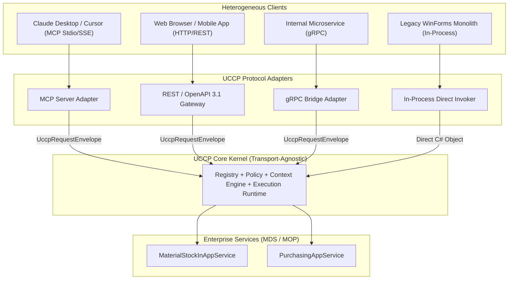

# UCCP Interoperability & Multi-Protocol Adapters

---

## 1. The "Define Once, Expose Anywhere" Substrate

A core architectural invariant of UCCP is that business logic is written exactly once within domain application services and exposed through pluggable protocol adapters.



---

## 2. MCP (Model Context Protocol) Adapter

The UCCP MCP Adapter enables any standard MCP client (Claude Desktop, Cursor, Zed, Sourcegraph Cody) to consume enterprise capabilities seamlessly without modifying the client.

### Translation Mechanics:
1. **Tool Discovery (`tools/list`)**:
   - The MCP adapter queries the UCCP Registry.
   - For clients with strict context limits, the adapter dynamically returns either:
     - The top-level Domain Meta-Tools (e.g., `uccp_query_domain`, `uccp_search_capabilities`).
     - Or the pre-filtered capability list mapped directly to standard MCP tool schemas.
2. **Execution (`tools/call`)**:
   - Incoming JSON-RPC `tools/call` parameters are wrapped into a `UccpRequestEnvelope`.
   - Security context is extracted from the connection headers (or local environment in Stdio mode).
   - UCCP executes the capability through its deterministic pipeline (Policy $\to$ Runtime $\to$ Service).
   - The UCCP response is mapped back to an MCP `CallToolResult`:
     - Text content contains the token-optimized summary.
     - Embedded JSON contains the structured payload and `contextHandle`.

```csharp
// Conceptual C# Implementation of MCP Tool Dispatcher
public async Task<CallToolResult> HandleMcpToolCallAsync(CallToolRequest mcpRequest, CancellationToken ct)
{
    var uccpEnvelope = new UccpRequestEnvelope
    {
        ProtocolVersion = "1.0",
        RequestId = Guid.NewGuid().ToString("D"),
        CapabilityId = mcpRequest.Params.Name,
        Payload = JObject.FromObject(mcpRequest.Params.Arguments)
    };

    var response = await _uccpRuntime.ExecuteAsync(uccpEnvelope, ct);

    if (response.Status == ExecutionStatus.Success)
    {
        return new CallToolResult
        {
            Content = new List<ContentBlock>
            {
                new TextContentBlock { Text = response.Summary },
                new JsonContentBlock { Data = response.Data }
            }
        };
    }

    return new CallToolResult
    {
        IsError = true,
        Content = new List<ContentBlock>
        {
            new TextContentBlock { Text = response.Error.Message }
        }
    };
}
```

---

## 3. REST & OpenAPI 3.1 Dynamic Gateway

The REST Adapter dynamically maps UCCP capabilities to clean HTTP endpoints:
- **URL Mapping**: `POST /api/v1/capabilities/{domain}/{subdomain}/{operation}`
- **OpenAPI Export**: Exposes a real-time `/openapi.json` generated on the fly from the Capability Registry. This allows legacy API management gateways (Kong, Azure API Management, Apigee) to discover and protect UCCP capabilities.

---

## 4. In-Process Native C# Invoker

In desktop ERP environments (such as DevExpress WinForms applications), network serialization is unnecessary and harmful to performance. The In-Process Invoker provides a direct memory execution bridge:

```csharp
public interface IUccpInvoker
{
    Task<UccpResponseEnvelope> InvokeAsync(
        string capabilityId, 
        object payload, 
        CancellationToken cancellationToken = default(CancellationToken));
}
```
- **Performance**: $< 0.1 \text{ ms}$ call overhead.
- **Zero Allocation**: Avoids JSON byte serialization by passing typed objects directly through in-memory interfaces.
- **Transactional Unity**: Can share an ambient `DbScope` or EF6 `DbContext` with the active WinForms form.
